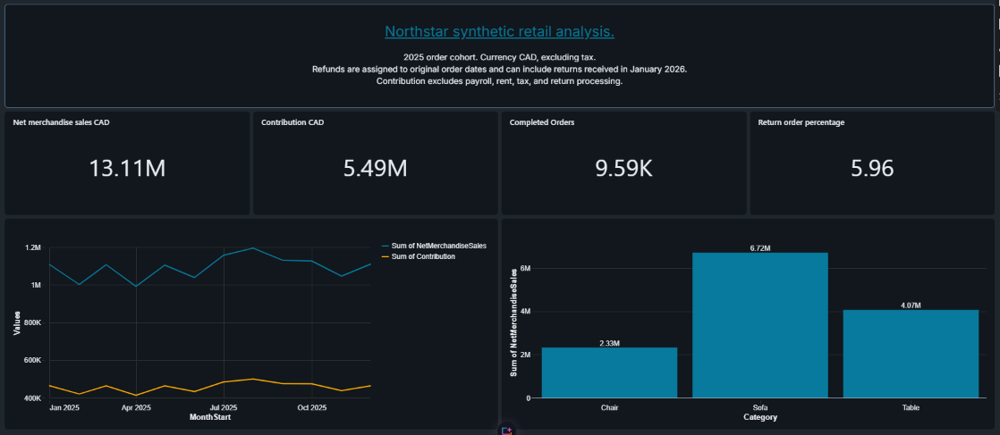

# Northstar Retail Sales and Returns Analysis

**A Data Analyst portfolio project using Databricks Free Edition, SQL, and AI/BI dashboards.**

I built a retail analytics dashboard to explore sales, returns, product performance, and modeled contribution for a fictional Canadian furniture retailer. The project uses synthetic data and supplied starter resources, with AI assistance for SQL development and explanations.

## Business question

Which product categories, channels, and provinces account for sales and modeled contribution, and which return patterns should a retailer investigate further?

The analysis covers monthly trends, category comparisons, shipping economics, return reasons, product rankings, and repeat purchasing. Recommendations are proposed next steps, not claims of implemented business improvements.

## Dashboard preview

[View the dashboard PDF](report/Northstar retail sales and returns.pdf)

The dashboard has three pages:

| Page | Analysis |
| --- | --- |
| Executive overview | Net merchandise sales, contribution, completed orders, return percentage, monthly trends, and category sales |
| Returns and products | Category return percentages, return reasons, and product contribution rankings |
| Channel and region | Shipping charges versus modeled shipping expense, channel results, and province comparisons |

The filtering design uses start date, end date, channel, and province parameters in the dashboard dataset queries. Parameters are applied before aggregation so that totals and rate calculations refer to the same selected orders.

Databricks dashboard links require appropriate account permissions. The repository screenshots and PDF are the employer-facing previews.

## Tools and analytical methods

- **Databricks Free Edition:** workspace, Unity Catalog volumes, Delta tables, SQL queries, and AI/BI dashboard authoring.
- **SQL:** joins, common table expressions, conditional aggregation, date grouping, `LAG`, `DENSE_RANK`, and safe division with `NULLIF`.
- **Data quality checks:** row counts, duplicate identifiers, missing relationships, dates, quantities, refunds, and reconciliation of financial totals.
- **GitHub:** project documentation, SQL source, dataset provenance, and dashboard evidence.

## Data source

The records were supplied for this independent portfolio project using an AI-assisted Python generator with **random seed 42**. Northstar Furniture is fictional and unrelated to Article or any other real retailer. No sales records were downloaded from a public dataset or taken from a real customer database.

| Source file | Rows | One row represents |
| --- | ---: | --- |
| `customers.csv` | 500 | One fictional customer and assigned province |
| `products.csv` | 30 | One product with a category, catalog price, and cost |
| `orders.csv` | 10,000 | One single-product order, including canceled orders |
| `returns.csv` | 572 | One return event linked to an order |

Orders cover **January through December 2025**. Returns can extend into January 2026. The reporting currency is **CAD**, and provinces are ON, BC, AB, and QC.

The companion `tickets.csv` file is not used in this sales reporting model. It is retained in the starter dataset for consistency with the optional generator.

## Data model and calculations

The `vw_order_finance` view maintains **one row per order**. Returns are aggregated by `OrderID` before being joined to orders, preventing multiple return records from multiplying sales. Customer and product tables supply province and category attributes.

Canceled orders contribute zero merchandise sales, sold units, shipping revenue, shipping cost, and merchandise cost. Orders with returns remain completed orders; returns are identified separately through returned quantities.

| Metric | Definition |
| --- | --- |
| Merchandise sales | Completed quantity × unit price − order discount |
| Net merchandise sales | Merchandise sales − merchandise refunds |
| Net merchandise cost | (Sold units − returned units) × unit cost |
| Modeled contribution | Net merchandise sales + shipping revenue − net merchandise cost − shipping expense |
| Average order value | Merchandise sales ÷ completed orders |
| Return order percentage | Orders with any returned units ÷ completed orders × 100 |
| Shipping gap | Shipping revenue − modeled shipping expense |

## Reference results for the supplied dataset

These are full-cohort reference values from the supplied dataset, before channel or province filtering. They provide a baseline for checking SQL and dashboard outputs; they do not establish that every dashboard filter has passed validation.

| Metric | Reference value |
| --- | ---: |
| Completed orders | 9,590 |
| Orders with returns | 572 |
| Net merchandise sales | CAD 13,113,433.25 |
| Modeled contribution | CAD 5,491,643.19 |
| Average order value | CAD 1,445.09 |
| Return order percentage | 5.9645% |
| Shipping gap | CAD −124,682.31 |

## Findings from the synthetic sample

### 1. Sofas have the largest sales total and highest return order percentage

| Category | Completed orders | Returned orders | Net merchandise sales CAD | Return order percentage |
| --- | ---: | ---: | ---: | ---: |
| Sofa | 3,116 | 327 | 6,718,589.50 | 10.49% |
| Table | 3,202 | 126 | 4,069,552.75 | 3.94% |
| Chair | 3,272 | 119 | 2,325,291.00 | 3.64% |

This illustrates why both sales and return percentages should be examined when comparing categories. The generator deliberately assigns sofas a higher return probability, so this pattern cannot establish real product performance.

Evidence: [category analysis](sql/analysis/02_category_results.sql).

### 2. Modeled online shipping charges do not cover modeled shipping expense

The full-cohort shipping gap is **CAD −124,682.31**. The model assigns a CAD 14.99 shipping charge and CAD 35 delivery expense to each completed online order. Store orders have zero shipping revenue and expense.

The gap follows those fixed assumptions. It is a component of modeled contribution, not an observed loss at a real company. Provincial total expense comparisons also reflect order volume; actual expense per order would be needed to investigate geographic cost differences.

Evidence: [province and channel analysis](sql/analysis/03_region_channel.sql).

### 3. Damage is the most frequent return reason by order count

The sample contains **194 damage-related returned orders**, compared with **191 for change of mind** and **187 for size**. The counts are close, so no single reason overwhelmingly dominates the sample.

A reason's order count and its total refund amount answer different questions. The most common reason does not necessarily have the highest refund amount.

Evidence: [return reason analysis](sql/analysis/04_return_reasons.sql).

## Proposed business follow-ups

1. **Investigate sofa returns with real records.** Examine reasons at product level, including dimensions, expectations, and damage reports. Use observed evidence to decide whether product information or delivery handling deserves a pilot.
2. **Compare actual delivery expense per completed online order by province.** Link carrier invoices to orders and assess contribution before considering changes to shipping charges or delivery arrangements.
3. **Prioritize returns using both frequency and financial impact.** Compare returned orders, returned units, and total refunds by reason; investigate the highest-impact combinations.

No reduction in returns, increase in revenue, or cost saving is claimed as an achieved result.

## Validation approach

The project provides checks to:

- Confirm 500 customers, 30 products, 10,000 orders, 572 return records, and 10,000 financial-view rows.
- Detect duplicate or missing IDs and broken customer, product, or order relationships.
- Identify invalid quantities, dates, shipping amounts, and refund calculations.
- Confirm canceled orders contribute zero to financial results.
- Reconcile SQL totals with the supplied reference results.
- Compare dashboard values with SQL for both the full cohort and a selected date, channel, and province slice.

Validation scripts are in [sql/setup](sql/setup). Actual execution results and any fixes should be recorded in `docs/validation_results.md`; reference values alone are not a record of a successful test.

## How to reproduce

1. Download or clone this repository and extract its files.
2. Open a personal Databricks Free Edition workspace and identify a writable catalog. This project uses the schema `northstar_project2`.
3. Set catalog names in the SQL scripts to your catalog. Replace existing catalog where present; scripts configured for `workspace` also need updating if your catalog differs. Update `/Volumes/` paths consistently.
4. Run `sql/setup/00_setup.sql` to create the schema and `source_files` volume.
5. Upload the four reporting CSVs into `/Volumes/<your_catalog>/northstar_project2/source_files/`.
6. Run `01_load_customers.sql`, `02_load_products.sql`, `03_load_orders.sql`, and `04_load_returns.sql` from `sql/setup`, in that order.
7. Run `05_finance_view.sql`, then `06_counts_and_quality.sql` and `07_control_totals.sql`. Investigate mismatches before using the results.
8. Run the SQL files in `sql/analysis` to reproduce the business analyses.
9. In the dashboard Data tab, create datasets using `sql/dashboard`. Keep the four parameter markers in the seven metric dataset queries. Set `start_date` and `end_date` to Date with defaults `2025-01-01` and `2025-12-31`; set `channel` and `province` to String with default `ALL`. Leave multiple selections off.
10. Build the three dashboard pages and connect global controls to the corresponding parameters across all seven metric datasets. The two choices datasets supply dropdown values; they do not filter the metric datasets by themselves.
11. Check the full-cohort totals and the filtered reference case: January 1–February 28, 2025, channel `ONLINE`, province `ON`. Compare with `expected-results/filtered_on_online_jan_feb.json`.
12. Publish the dashboard after checking it, export previews, and retain the SQL and validation evidence with the repository.

The optional Python generator recreates the supplied CSVs; it is not required to begin. Changing its seed or assumptions requires recomputing reference results and deliberately reloading the Databricks tables.

## Limitations

- All records are synthetic. Customer, product, channel, and return patterns are generated assumptions rather than market evidence.
- One order contains one product. The supplied sample has at most one return event per order.
- Refunds are attributed to the original order date, including returns received in January 2026. This is an order-cohort report, not a cash-refund-by-month report.
- Returned merchandise cost is assumed recovered. Contribution excludes payroll, rent, tax, return handling, and resale losses, so it is not net profit.
- Static prices and shipping costs simplify real retail operations. The fixed delivery expense cannot establish regional cost variation.
- Random customer assignment can produce a high repeat-purchase percentage that does not demonstrate actual customer loyalty.
- A single synthetic year cannot establish seasonality, causal effects, or the impact of a proposed business change.

## Contribution and assistance

My work focuses on implementing the Databricks analysis, building and publishing the three-page dashboard, and interpreting its outputs. The dataset generator, initial guide, and starter queries were supplied with AI assistance. I used AI explanations and query corrections during development; I do not claim to have independently authored all starting resources.

Further extensions could compare return percentages for discounted versus full-price orders within each category, followed by checks at product level. This is a proposed extension, not a claim that its results are already included in the dashboard.
